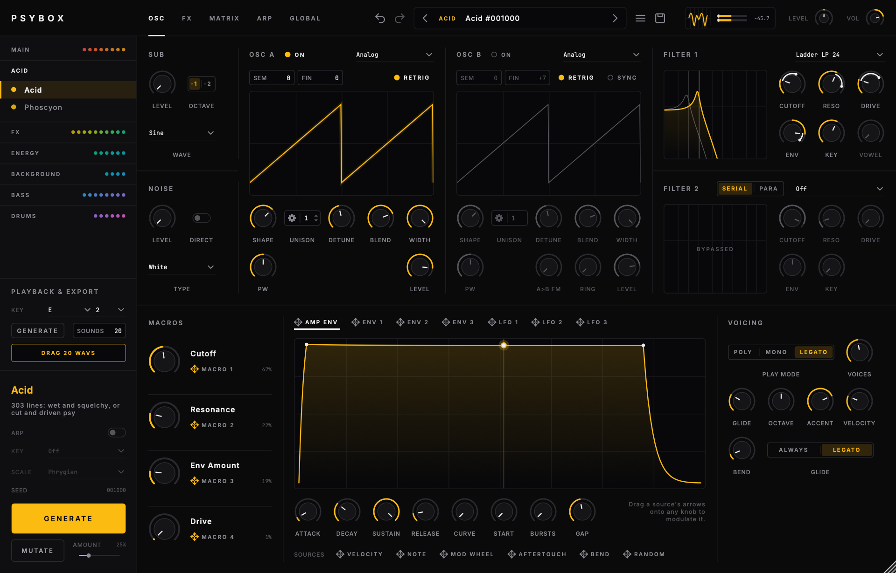

# PsyBox

A synthesizer for psytrance sound design. Pick a category, press **Generate**,
and you get a new sound of that kind. It could be an acid line, a zap, a rolling
bass, a riser or a kick. Every knob stays live, so a generated patch is a
starting point you can edit as far as you like.

Builds as **VST3**, **Audio Unit** and **Standalone** (macOS).



## Categories

38 kinds of sound, each with its own recipe, in six groups in the sidebar.
Each group is a header; click one to open it and its sounds fold out under
it, while closed groups show a dot per sound. The accents run as one rainbow
down the whole list: red at the first sound of the first group, through
every group, to magenta at the last kick.

- **Main**: Acid · Ghost Stab · Grid · Jilax · Pluck · Psy Lead · Stab
- **FX**: Alien Voice · Bubble · Glitch · Gurgle · Laser · Metallic · Screech · Squelch · Wobble · Zap
- **Energy**: Downlifter · Impact · Noise FX · Reverse · Riser · Uplifter
- **Background**: Atmos · Drone · Gate
- **Bass** and **Kick**: below

### Ghost Stab

Ghost Rider's offbeat stab, fitted to 28 of his tracks (2014-2025): each one
split into stems, the stab and the bass measured in every main section, and
generated patches rendered and measured the same way. The chord comes in on
the "and", holds (sagging a dB or two) and is gone just before the next
kick. It is a stack of fifths (root, fifth and octave from Osc A's unison
stack, often a twelfth or an octave from Osc B), a few voices moderately
detuned, high-passed under its root (the high-pass follows the key), and a
gentle one-pole low-pass for the 6-8 dB per octave his stabs fall above
1.4 kHz. Wide: the Width stage puts the side about as loud as the mid above a
mono low end, with reverb and a dotted-eighth or quarter echo behind it, and
no compressor to dent the hold. With **Arp** ticked one held key plays a riff
of chords in the key, mostly on 1/16: the "and" tied to the kick, with beats
rolled on the sixteenths after the kick, doubled on the "and" and "a", pushed
to the last sixteenth, held for a beat and a half or left out, in a bar form
that turns around at its end (on 1/8, two bars of offbeats and holds). The
chords move every beat, every half bar, or hold and turn at the end, now and
then a sixteenth ahead of the beat; no stab starts on the kick.

### Grid

The short hits a full-on groove is built from, the "grids" of the sample
packs: FM blips, plucks, small chord stabs and ring-modulated ticks, each over
in a sixteenth or two, high-passed above the bass. Every hit comes out a little
different (a new random value per note, or a sample & hold on the 16ths, on
the brightness or the FM index), and some get a click from a quick pitch drop.
Dry, with a ping-pong echo on the grid. With **Arp** ticked a grid plays
straight 16ths with short gates: one-beat cells that leave most beats to the
kick and play the "e", "and" and "a" around the bass, a Euclidean figure
turned off the beat, or the dotted-eighth run, sometimes a three-beat loop
against the bar. The line keeps to the key with octave and fifth jumps, and
the last half-bar answers the first.

### Jilax

Psytrance synth shots: one hit of a beat (sometimes two) at the tempo, the way
sample packs sell them. Every recipe value was fitted to 500 reference shots by
rendering hundreds of generated ones the same way and comparing level over the
shot, brightness and how it moves, octave bands, harmonics, stereo width and
density. The way each part is built follows Jilax's own Serum patches. A shot
is:

- **A bass-register saw stack, high-passed.** The root sits two octaves under
  the key (E3 plays an E1 root, like the reference "E" shots), and a steep,
  slightly resonant high-pass at 160-330 Hz takes out the fundamental, so the
  energy sits in a dense comb of harmonics from the 4th up. Often a second
  stack an octave and a fifth up (+19), sometimes a noise layer. Some shots are
  supersaws, wavetables (scanned over the hit), squares, FM tones or minor and
  major chords (a unison stack of octave and fifth plus a third on osc B), an
  octave or two higher.
- **Wide and thick**: up to sixteen unison voices at a moderate detune with
  free-running phases and full width, plus stereoize and chorus, so the side is
  about as loud as the mid and the gaps between the harmonics fill in. About
  one shot in five is close to mono instead.
- **Dense**: a clipper at the end of the chain (Distortion, mostly hard, with
  **Auto Level** and **Low Cut**), after OTT-style multiband compression. On
  the brightest third the compressor's high band lifts the upper mids.
- **One gesture**: a hold that slides down a few dB, a decay, a swell, a hit
  that rings out through the next beat (reverb and release), or a trance gate;
  the low-pass (often a ladder) closes over the hit in about half the shots, by
  an envelope or by an LFO synced to the beat (the hit then often starts thin
  and bright, the high-pass coming down with the filter), stays open, opens or
  rises and falls in the rest; one in ten zaps, falls or rises in pitch. Most fade over
  the last tenth of their length.

Jilax uses the Length panel (one beat by default, Cut at End) with **One Shot**
on: a tap plays the whole shot, like a sample. It has no arp. Drag the output
window to bounce a shot as a WAV.

### Energy

Risers, downlifters, impacts and the rest are one gesture over a **Length**:
in bars by default (it follows the tempo), or in seconds. Switch between
**Bars** and **Time** and the length keeps sounding the same. Energy sounds
have no arp; their Length panel sits under the voicing.

The length drives the **Sweep**, a mod source that climbs from 0 to 100 % from
the note start. The recipes hang pitch, filter and level on it, so changing
the length stretches the whole riser. **Curve** bends the sweep (slow start
and a fast finish, or the other way round), **Fade** makes the level follow it
(in for risers, out for downlifters and impacts), and **Cut** stops the note
at the end however long it is held (Reverse). **One Shot** plays the whole
length from a tap, like a one-shot sample: letting go of the key doesn't stop
it (Jilax). Drag the Sweep onto any knob to move that knob with the gesture
too. Riser is a synth tone climbing in pitch; Uplifter is a noise sweep that
opens upward.

### Basses

Seven bass styles, under the **Bass** tab:

Bass Shot · Ghost Bass · Offbeat Bass · Prog Bass · Psy Bass · Reverse Bass · Reverse Sub

Basses play on the synth engine, mono and dry, and have no arp: you play their
rhythm. Their **Knock** panel (under Voicing) holds the pitch drop at the start
of every note. Each recipe was fitted to reference samples (harmonics over time, pitch
knock, envelope, loudness, stereo):

- **Psy Bass**: the rolling 16th-note psy bass. A saw through two low-passes in
  series (one follows the key, one fixed near 250 Hz), a filter burst and a
  pitch knock on every 16th, full level for the note and a dead stop.
- **Prog Bass**: rounder and darker. One 12 dB low-pass fixed near 120 Hz
  whatever the key, a softer burst and knock.
- **Ghost Bass**: Ghost Rider's rolling bass, fitted to his tracks (see Ghost
  Stab). No knock: a saw through a 12 dB low-pass fixed near 150 Hz and a
  high-pass at 55-78 Hz that thins the fundamental to about the second
  harmonic's level (his kick owns the sub), with a slight filter flick at
  every note. Within 0.7 dB of his notes over the first twelve harmonics.
  Roll it on the "e", "and" and "a", or hold longer notes as bass stabs.
- **Offbeat Bass**: one note between the kicks. A big pitch knock, then a
  low-pass that closes from a bright pluck to almost a sine, and a slow tail
  after the key is let go.
- **Bass Shot**: the progressive-trance one-shot. A saw over a body
  oscillator, a kick-like pitch drop, saturation and direct noise grit,
  multiband compression, and width above a mono low end.
- **Reverse Bass**: a bass shot played backwards, for the beat before a kick,
  fitted to twelve bright reverse shots by rendering and measuring. Always a
  saw with a rounder wave and a spike each cycle, and a fizz above 10 kHz
  (the Noise section's **Hiss**: the bite of a distorted top). It is there
  from the first moment, quietly (the amp envelope's **Start**), swells late
  and fast, holds, and stops dead after its **Length** (one beat, however
  long the key is held). From patch to patch it starts 7-30 dB down and is
  full at 30-60 % of the beat; it may be darker, dip around 500 Hz, open its
  filter through the swell, add an octave saw, fall onto the note at the
  end, or spread its top in stereo.
- **Reverse Sub**: the same for a sub, fitted to three reference shots. It
  swells from silence to full at about 57 % of the beat, holds its pitch,
  then slides from just past the middle to the end (the Length panel's
  **Delay**): a fifth or an octave down from an octave up, as a warm sine
  (a quiet octave above for the second harmonic, a little tube), or a fourth
  or fifth up from the note, easing in, as a saw through a band-pass that
  follows the key.

A glue compressor with make-up gain puts the basses level with the kicks; the
reverse basses only get the make-up, so their swell keeps its shape. Their
Length panel sits where the other basses have the Knock.

### Kicks

Five kick styles, under the **Kick** tab:

Dark Forest Kick · Full-On Kick · Goa Kick · Hi-Tech Kick · Progressive Kick

A kick category switches the synth to a dedicated kick engine, and the OSC
view becomes the KICK view: the kick's Pitch, Amp, Click, Drive and wave
sections. The FX and Global views stay. Kicks have no arp, macros or matrix.

- **Tuned to your key.** With **Key** on (the default), the kick's body lands on
  the key you play. Any octave of the key gives the same kick, placed within
  half an octave of **Tune**. Turn Key off and every note plays at Tune. The
  **Tune to key** switch under Generate decides whether new kicks come with Key
  on; it only shows in kick categories.
- **Pitch** falls in two exponential stages: from **Start** to the **Knee** in
  about 3 × **Snap**, then into the body in about 3 × **Sweep**. Both stages land
  exactly on their target, so the body is in tune rather than slowly sagging.
- **Amp**: **Attack**, **Hold** and **Decay** shape the body. **Punch** keeps the
  first milliseconds at full level while the body fades in, which gives the
  knock of a progressive kick.
- **Click**: band-passed noise, a short tick or a falling blip, with level,
  decay and tone.
- **Drive**: Soft, Tube or Hard saturation on the body, oversampled with the
  rest of the engine, plus a tone low-pass.
- Every hit starts at the same phase, so repeated kicks are identical. A new hit
  fades the previous one out over 3 ms instead of cutting it. Drag the output
  window out to get the kick as a one-shot WAV.

The Progressive recipe is tuned against measured progressive kicks. The pitch
falls from about 2 kHz through a knee of about 330 Hz into a 38–53 Hz body. The
body holds flat to about 160 ms and is down 30 dB by about 220 ms.

## How it works

- **Generate** runs the category's recipe with a random seed. A recipe is a set
  of ranges and rules: which oscillator types, which filter, how the envelopes
  move, which LFOs and effects are routed where.
- **Mutate** nudges the current sound and stays inside the category's ranges.
  The amount slider sets how far.
- **Every patch plays about as loud.** After Generate, Mutate or a new arp
  pattern, the patch is played offline the ways it is usually played (a held
  key and 16ths from C2 to C5, the arp, a riser over its length, kicks four to
  the floor) and its loudest moment is measured (K-weighted, 400 ms, like
  LUFS). **Level** (top bar, next to Vol) is set so that moment lands on
  -16 LUFS, so a new patch never jumps out louder than the last. Volume stays
  yours; lock Level to keep your own.
- **Lock** a knob (right-click it, or alt-click) and Generate and Mutate leave
  it alone.
- Tick **Arp** next to Generate and every new Main, FX or Background sound
  comes with an arp in the style of its category: tied 303 slides for acid,
  random blips for bubbles, offbeat 16ths for grids, each with a freshly generated step pattern and a
  line on its note lane, so holding one key already plays a riff. Riffs are
  built from each category's figures in bar forms (AAAB, ABAB, ABAC...),
  turned off the beat, pushed into the next bar and answered, so each press
  of Generate writes a different one. The
  sound itself is the same with or without it; only the arp settings differ.
  Energy sounds, basses and kicks have no arp. Set a **Key** and scale under
  the Arp switch (Phrygian, Minor, Harmonic Min, Phrygian Dom, Dorian, Major)
  and new lines are written in it, and the arp plays every note in that scale
  whichever key you hold (hold the key itself to hear the riff from its
  root). Off leaves the scale to each pattern and plays notes as they come.
- The same category and seed always give the same sound. Double-click the seed
  in the sidebar to type one in.
- Each category remembers its patch. Switch from Acid to Zap and back and your
  Acid sound is exactly as you left it. The first visit to a category generates
  a fresh sound.
- **Undo** and **Redo** in the top bar step through your Generate and Mutate
  history.
- **Macros**: every Generate gives all four macros a job (cutoff, resonance,
  reverb, drive...) and names them after it: "Cutoff", "Env Amount", "Filter +
  Space". The names follow the matrix, so dragging a macro onto another knob
  renames it too. Double-click a name to type your own; clear it to go back to
  the automatic one. Generate also sets where each macro knob starts, part way
  along so it turns both ways; a Cutoff macro lowers the filter's own knob to
  match, so the sound keeps its brightness and the macro opens or closes it
  from there (basses exactly so, and their reverb and delay macros stay at 0).
  Mutate moves the macros too.
- Leads, plucks, stabs, pads, drones and risers now and then get **unison**
  (a few voices, a little detune, wide); basses always keep one voice.
- The **output window** in the top bar shows the scope and a stereo level
  meter: RMS bars over peak bars, a held peak tick and its value in dB, red
  when the output clips. Drag it out to drop the current sound into your DAW
  as a WAV.
- Presets are saved to `~/Music/PsyBox/Presets/<Category>/`.

The standalone app has a keyboard strip at the bottom. Click the keys or play
from the computer keyboard (`A W S E D F T G Y H U J K` = C4 up, `Z`/`X` shift
the octave). A MIDI controller works too: *Options → Audio/MIDI Settings*.

## The editor

Laid out like Serum. The tabs in the top bar switch views:

- **OSC**: sub and noise, the two oscillators (laid out like Serum 2's: the
  SEM and FIN pitch fields, the waveform, then the knobs with the UNISON
  field), the two filters; underneath the macros, the modulators and the
  voicing, with the Length (Energy) or the Knock (Bass) under it. The
  waveform draws every unison voice drifting past the others as fast as its
  detune makes it beat; while you change a unison setting the voices also show
  as lines across the detune range. The filter curves follow the newest note,
  so envelopes, LFOs, macros and automation move them; the knob setting stays
  as a faint curve underneath.
- **FX**: a rack like Serum 2's. The chain on the left lists the nine effects
  in signal order: click a row to switch one on or off, drag it up or down to
  move it in the chain. On the right, each effect is a strip in the same
  order: badge, knobs, a display of what it does (curve, steps, echoes, reverb
  tail, stereo fan...), Mix and a power switch. Switched-off strips grey out.
  The order is saved with the patch and undoable; Generate starts a new patch
  in the default order. Distortion first runs oversampled; later in the chain
  it runs at the base rate (its shaper is anti-aliased).
- **Matrix**: the 16 modulation routes as rows: source, amount, target.
- **Arp** (Main, FX, Background): the step editor (play, note, accent and
  slide lanes, a ruler for the loop length), rate, octaves, gate, swing,
  generate a new pattern, and the templates as cards under the steps.
- **Global**: oversampling quality, once for playing (Live) and once for
  renders (Render: host export, bounce or freeze, and the WAV dragged out of
  the output window; 4x by default). Always the last tab.

**Drag and drop modulation.** Every mod source has a four-way arrow: the
envelope and LFO tabs, the macros, the Sweep and the strip of other sources
(velocity, note, mod wheel, aftertouch, bend, random). Drag it onto any knob
that can be modulated (they show a dashed ring while you drag) and a route is
added. The route shows as a ring between the knob body and its track; drag the
ring up or down to set the amount, right-click the knob to invert or remove
it. Sources can modulate each other: drop LFO 2 on LFO 1's rate. Effect knobs
take modulation too; per-voice sources (envelopes, velocity) follow the newest
note there.

## Sound engine

### Oscillators

Two per voice, plus sub, noise and ring mod.

- Analog: continuous saw / pulse / triangle morph with 4-point polyBLEP and
  polyBLAMP, PWM and hard sync with band-limited corrections
- Supersaw: 7 voices with the JP-8000 detune and mix curves
- Wavetable: 8 procedural tables, mip-mapped per octave from FFT spectra
- FM: 2-operator phase modulation with feedback, plus osc A → B FM

Unison per oscillator, like Serum 2: up to 16 voices with **Detune**, **Blend**
(centre against side voices, the level held constant) and **Width** (stereo
spread; the filters then run per side). The gear on the UNISON field opens the
rest: **Mode** (Linear, Super, Exp, Inv, Random spacing), **Stack** (12, 12+7,
24, or the centre an octave or two down), **Range** (how far Detune reaches, 2
semitones by default) and **Spread** (each voice its own shape, wavetable
position or FM index). The Supersaw is its own seven-voice unison.

### Filters

Two slots, serial or parallel.

- Low-pass and high-pass at 6, 12, 18 and 24 dB/oct (TPT state-variable
  sections with Butterworth tunings)
- Band-pass 12 / 24, notch
- Transistor ladder in LP 12, LP 24, HP and BP modes, with the saturating
  feedback solved by Newton-Raphson each sample
- Diode ladder (303 style), calibrated so the resonant peak sits on the cutoff
- Formant (vowel morph) and positive/negative comb

### Voices and modulation

16-voice poly, mono and legato with glide, 303-style accent and
slide. Voices run at 1x, 2x or 4x and come back through linear-phase half-band
FIR decimators. Drive happens before decimation and uses antiderivative
anti-aliasing.

The amp envelope (its attack has a Curve: from an analog-style charge to a
slow-then-fast swell) and Env 1 to 3 (Env 1 also drives the filters' Env knobs,
Env 3 is the pitch envelope), 3 LFOs (tempo sync, retrigger, S&H, smooth
random), the energy Sweep, 4 macros and a 16-slot mod matrix whose targets
include the effects. The envelope, LFO and Sweep displays run live: a dot per
sounding voice moves along the curve, the newest with a playhead.

Nothing clicks by accident. A voice's level moves at most a full note's level
per millisecond, so an instant attack, a retrigger, a 1 ms release or a
square-LFO gate chop becomes a ramp of about 1 ms; slower envelopes pass as
they are. A fresh note's oscillators fade in over 1 ms before the filters, so
a resonant filter doesn't ring on their first step. A retriggered or stolen
voice that still sounds fades out over 3 ms in a spare slot while the new note
starts clean. LFO edges are rounded over 0.35 ms, and a filter closes at most
half an octave per millisecond (it still opens at once). A kick fades out over
3 ms at the end of its envelope.

Arpeggiator (Arp view): Up, Down, Up/Down, Random and played order
over 1 to 4 octaves, with rate, gate, swing and hold, playing a 16-step pattern
with per-step accent, slide and note (up to two octaves up or down from the key
the mode picked) and a loop length of 1 to 16 steps. Generate writes a new
pattern in the category's style every time: a rhythm from the category's
figures (303 motifs, rolling, offbeat, 3-3-2, Euclidean loops, fills into the
next bar) and a line in a psy scale (Phrygian, minor, harmonic minor, Phrygian
dominant, Dorian) that repeats and answers itself. Acid sits on the key and
jumps an octave on its accents, leads play broken chords through a
progression, lasers fall down a chord, pads and gates play slow broken chords
on a moving progression, drones walk it and climb inside each chord, stabs
lead with their top note. Every pattern plays at least three notes (nearly
always). In the Arp
view: paint steps, drag a note up or down (scroll, double-click to reset), set
the length on the ruler, shift, clear, click a template card (Rolling, Gallop,
3-3-2, Acid line...; it keeps your notes) or generate just a new pattern. The arp locks to the host
transport while it plays. Slides, and gates of 100 % or more, tie: the voice
glides to the next note without retriggering, so 303 slides and long sweeps
keep running.

### Effects

Distortion (5 types), bitcrusher, Hilbert frequency shifter,
phaser, chorus / flanger, compressor, ping-pong delay, an 8-line FDN reverb
and a stereo width stage, in that order.

The distortion has a **Low Cut** after its shaper (off at 20 Hz): clipping a
high-passed sound brings its root back as a difference tone, and the low cut
takes it out again. Cutting the lows under a clipped wave turns its flat tops
into spikes, so the peaks the low cut raises are trimmed back to the clipper's
ceiling, without bringing the lows back. **Auto Level** measures the drive from the sound's own
level instead of from full scale (an RMS follower in front of the shaper, the
level given back after it): the clipper bites the same on a quiet patch as on a
loud one, and a decaying sound keeps its decay instead of being held up at the
clip level. When the distortion runs at the base rate (anywhere but first in the
chain, or at 1x quality) a small filter undoes the dulling its anti-aliasing
would cause (from -6 dB at 15 kHz to within 2 dB).

The compressor has two modes. **Normal** is a single-band, soft-knee compressor
with a parallel mix. **Multi** is a three-band upward + downward compressor in
the OTT / Serum style: drag each band's down and up thresholds and the two
band splits in the display, set the band gains, Depth, Down and Up amounts.
It is built to stay clean: Linkwitz-Riley bands that sum flat, a detector
that holds a whole waveform cycle (no distortion on low notes), stereo-linked
detection, Depth applied per band (no comb filtering against the band
filters), upward gain that fades out near silence, and click-free switching.

**Width** comes last, so it also cleans up delay and reverb. **Low Mono** folds
everything under the split to mono (a Linkwitz-Riley split on the side
channel only). **Width** scales the stereo above it, and **Stereoize** makes
stereo out of mono voices (a short Haas side from the mid). Left + right
never changes, so the mix stays mono-compatible.

The Noise section's **Direct** switch adds the noise after the filters, for
bright grit over a dark sound.

## Building

Requirements: macOS 11+, CMake 3.24+, Ninja, Xcode command line tools.

```sh
cmake -B build -G Ninja -DCMAKE_BUILD_TYPE=Release
cmake --build build
```

This installs the VST3 and AU into `~/Library/Audio/Plug-Ins` and builds the
standalone app at `build/PsyBox_artefacts/Release/Standalone/PsyBox.app`.
JUCE 8 is downloaded automatically. To use a local checkout instead, pass
`-DFETCHCONTENT_SOURCE_DIR_JUCE=/path/to/JUCE`.

### Releases

Push a version tag and GitHub Actions builds the installers and attaches them
to a new release:

```sh
git tag v1.2.0 && git push origin v1.2.0
```

You get a macOS `.pkg` (universal, VST3 + AU + standalone), a Windows setup
`.exe` (VST3 + standalone) and a zip of the bare plug-ins for each. A suffix
such as `v1.2.0-beta.1` makes it a pre-release. The installer scripts are in
`packaging/`.

The macOS build is signed with a Developer ID and notarized when these
repository secrets are set (Settings > Secrets and variables > Actions):

| Secret | Value |
|--------|-------|
| `MACOS_CERTIFICATES_P12` | base64 of a `.p12` holding both the *Developer ID Application* and the *Developer ID Installer* certificate with their keys |
| `MACOS_CERTIFICATES_PASSWORD` | the `.p12` password |
| `NOTARY_APPLE_ID` | Apple ID of the developer account |
| `NOTARY_PASSWORD` | an app-specific password for that Apple ID |

Without them the macOS build is unsigned and macOS blocks the `.pkg` the first
time (System Settings > Privacy & Security > Open Anyway). The Windows
installer is not signed, so SmartScreen asks once (More info > Run anyway).

### Core only

The DSP, engine and generator don't depend on JUCE. They build and test in
seconds:

```sh
cmake -B build-core -G Ninja -DCMAKE_BUILD_TYPE=Release -DPSYBOX_BUILD_PLUGIN=OFF
cmake --build build-core
./build-core/psybox_tests                  # aliasing, filter response, stability, determinism
./build-core/psybox_render <out-dir> 3     # 3 WAVs per category
```

## Project layout

```
src/core/dsp        oscillators, filters, shapers, oversampling, effects
src/core/engine     parameters, voices, engine
src/core/generator  categories, recipes, generate / mutate
src/plugin          JUCE processor and editor
src/ui              theme, widgets, panels, pages (views), displays
tests/              Catch2 tests for the core
tools/              WAV renderer, offscreen UI snapshot tool
```

## License

The plugin links JUCE 8 under the AGPLv3.
